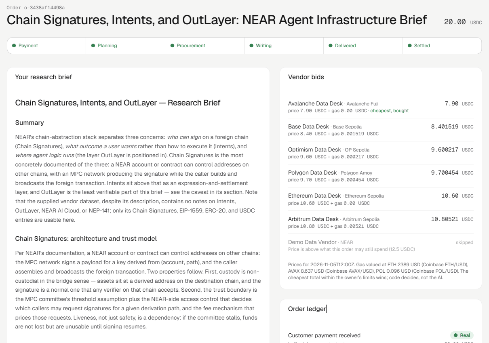
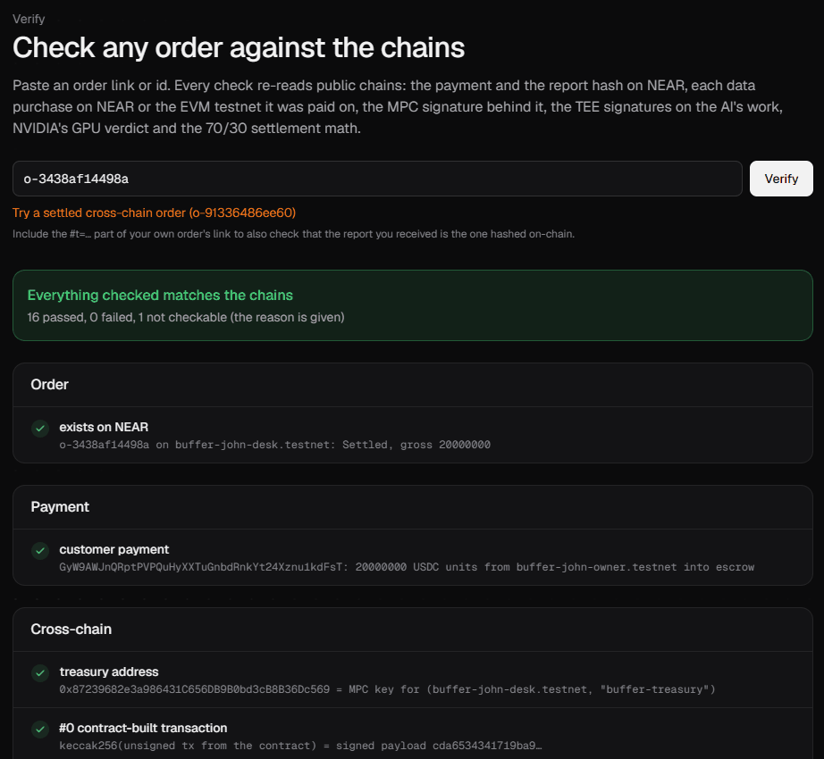
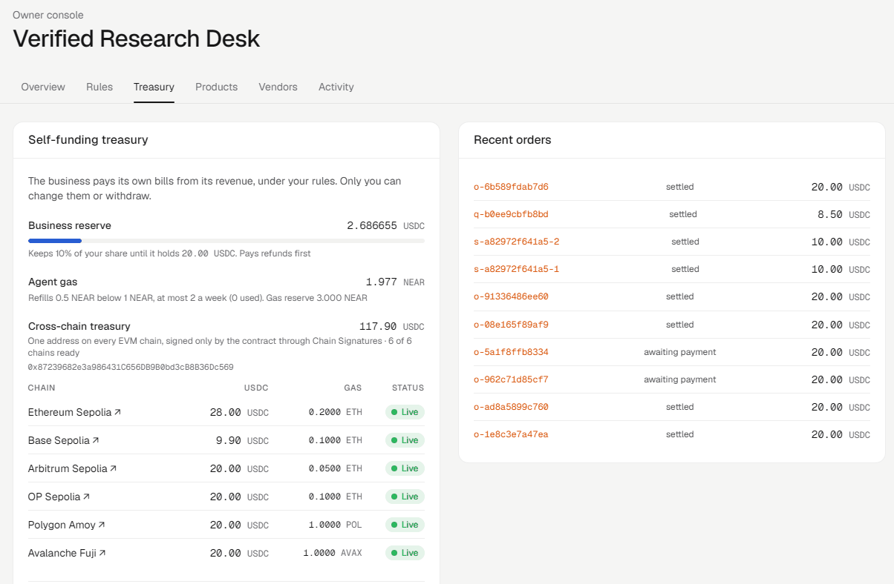
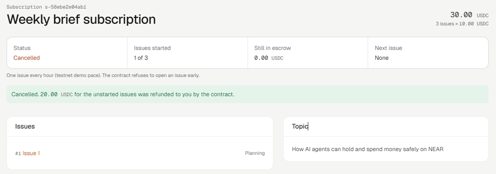
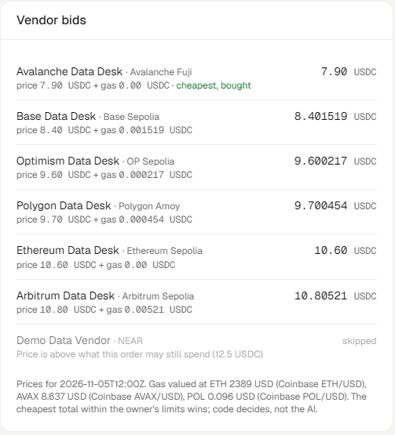
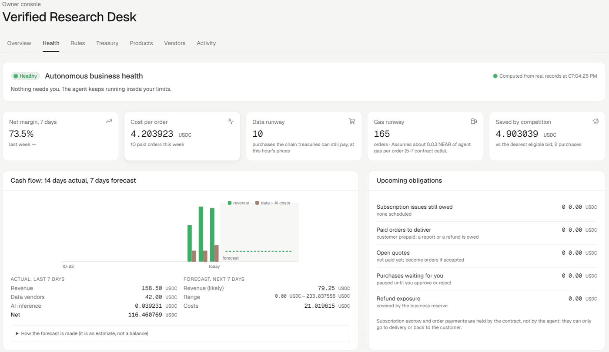

# Buffer

**An autonomous business on NEAR. The owner sets the rules, AI runs the business, and a smart contract protects the money.**

Buffer is an experiment in running a business with an AI agent instead of a large team.

The owner decides how the business should operate: what it can spend, which vendors it can use, when it needs approval and how revenue is shared.

The AI agent handles the day-to-day work. It receives orders, finds the data it needs, pays approved vendors, prepares research briefs, delivers them to customers and settles the revenue.

The money stays in a NEAR smart contract. The agent cannot change the owner's rules or spend outside the limits.



## The first business: Verified Research Desk

The first business running on Buffer sells research briefs.

Customers can:
- Buy a research brief for 20 testnet USDC.
- Subscribe to receive multiple briefs.
- Request custom research and receive a price based on a fixed formula.

**Live demo:** https://buffer-zeta.vercel.app

**NEAR Hackathon 2026 tracks:** Autonomous Business (`business`), Agent Economy (`agents`) and AI Security (`security`).

Testnet only. No real funds are involved.

## Try Buffer in five minutes

You can explore most of the project without connecting a wallet.

**1. Check the public ledger**

Open [/ledger](https://buffer-zeta.vercel.app/ledger).

You'll see payments, vendor purchases and payouts, along with their status. Rows marked `REAL` link to the transactions that happened on NEAR or an EVM testnet.

**2. Verify an order**

Open [/verify](https://buffer-zeta.vercel.app/verify) and select **Try a settled cross-chain order**, or enter an order link or ID.



You can also verify an order yourself from the terminal:

```bash
npm install
npm run verify -- o-91336486ee60
```

The verifier checks the payment, vendor purchases, report hash, revenue split, AI signatures and NVIDIA GPU attestation. It reports which checks passed or failed.

**3. Test the security**

Visit [/security](https://buffer-zeta.vercel.app/security).

I tested seven attacks against the business, including attempts to trick the AI, pay unapproved vendors, change the owner's rules and spend too much.

The page shows what happened and which security layer stopped each attempt. You can also follow the failed transactions on-chain.

**4. Open the owner console**

Visit [/app](https://buffer-zeta.vercel.app/app).

The owner can check the business, review approvals, pause the contract, freeze the agent's wallet, manage policies and view treasury activity.

Owner actions require the owner's signature.

**5. Create a business plan**

Visit [/new](https://buffer-zeta.vercel.app/new).

Describe a business and its rules in plain English. Buffer generates a policy and launch checklist. This currently prepares a plan; it does not deploy a new business automatically.

**6. Check business health**

Inside the owner console, open **Business health**.

You'll find revenue, costs, estimated runway, outstanding orders, risks and actions taken or suggested by the agent.

## Try a complete order yourself

You'll need a NEAR testnet wallet, such as Meteor, with some testnet NEAR and Circle testnet USDC.

You can get testnet USDC from [Circle's faucet](https://faucet.circle.com/) by selecting NEAR testnet.

1. Open [/store](https://buffer-zeta.vercel.app/store).
2. Choose **Weekly Market Brief**, enter a topic and select **Continue to payment**.
3. Approve the 20 USDC payment in your wallet.
4. The payment goes to the business contract, not the AI agent.
5. Watch the order move through Planning, Procurement, Writing, Delivered and Settled.
6. If a purchase is above the owner's approval limit, the order waits for approval.
7. Once the order is settled, the report and its on-chain hash are available on the order page.

You can then run the independent verifier:

```bash
npm run verify -- <the-order-URL>
```

To test refunds, start a subscription with three issues. Once the first issue has started, select **Cancel and refund**. The contract returns the money for the issues that haven't started.

## How Buffer works

### The owner sets the rules

The owner controls the business through a policy that defines:
- How much the agent can spend.
- Which vendors it can pay.
- Minimum prices.
- When owner approval is required.
- How revenue is divided.

The policy is hashed and stored in the contract. Before acting, the agent checks that its copy matches the owner's signed version.

Changing a rule in plain English does not change the business immediately. The owner must review and sign the new policy.

### The contract controls the money

Customers pay the business contract. The contract decides which payments are allowed.

It can:
- Pay approved vendors.
- Enforce spending limits.
- Wait for owner approval when required.
- Settle the 70/30 revenue split.
- Manage the business reserve and refunds.

The AI cannot simply choose a wallet address and send money to it.

### Private AI and agent custody

Buffer uses NEAR AI Cloud for private inference. Responses are signed, and NVIDIA's attestation service checks the GPUs used.

The agent's key is held by OutLayer inside a trusted execution environment (TEE). Its signing policy restricts it to calling the business contract.

These checks add protection around the AI and its ability to act.

## What happens when a customer places an order?

1. **Payment:** The customer pays 20 USDC into the business contract.
2. **Planning:** The agent works out what information is needed using NEAR AI Cloud.
3. **Procurement:** Approved vendors compete to provide the required data. The system compares their costs and chooses the cheapest allowed option.
4. **Approval:** If a purchase exceeds the owner's approval threshold, it waits for the owner.
5. **Research:** The agent prepares the brief. Its SHA-256 hash is recorded on-chain.
6. **Settlement:** The contract reimburses eligible business expenses and distributes the remaining revenue.

The default split is 70% to the owner and 30% to the contributor, after costs.

## The business can fund some of its own operations

Buffer includes a self-funding treasury.

**Reserve:** A portion of the owner's share is kept in a business reserve until it reaches its target. The default is 10% of the owner's share, with a 20 USDC target.

**Refunds:** If a paid order has to be refunded after some of its money was already spent on data, the reserve covers the gap first. The owner only needs to add money if the reserve isn't enough. (Cancelled subscriptions are refunded from their own escrow.)

**Agent gas:** The owner funds a NEAR gas reserve. If the agent's wallet falls below the set amount, it can request a refill. The contract enforces a weekly limit.

**Cross-chain treasury:** The business also has an EVM treasury for vendor payments, funded by the owner and reimbursed at settlement. Moving USDC from NEAR to the EVM chains automatically would need NEAR Intents, which is not available on testnet, so that step is not performed in the current setup.

Only the owner can change treasury rules or withdraw reserve funds.



## Subscriptions

Customers can prepay for several research briefs at once.

- Each issue costs 10 USDC.
- Customers can pay for 2 to 8 issues.
- The contract holds the subscription funds.
- The agent starts each issue when it is due.
- Each issue follows the normal research and settlement process.
- Customers can cancel at any time and receive a refund for issues that haven't started.

The schedule is adjustable. Testnet uses shorter intervals so the subscription can be demonstrated more quickly.



## Custom quotes

Customers can also request research that doesn't fit the standard products.

Here's how pricing works:

1. The AI estimates the work involved.
2. Code calculates the price using a fixed formula.
3. The customer sees the price breakdown.
4. The contract checks that the quote follows the owner's rules.

Quotes must be between 5 and 50 USDC. The allowed expense budget cannot exceed 60% of the price, and quotes expire after 30 minutes.

The AI estimates the work, but it does not choose the price or set its own spending limit.

## Vendors compete across seven chains

When the agent needs external data, it can compare approved vendors on (all testnets):

- NEAR testnet
- Ethereum Sepolia
- Base Sepolia
- Arbitrum Sepolia
- OP Sepolia
- Polygon Amoy
- Avalanche Fuji

The system considers the vendor's price and the cost of gas on that chain.

A vendor is skipped if it isn't approved, costs too much or the treasury cannot afford the purchase.

Code chooses the cheapest eligible offer. If two offers cost the same, NEAR wins.



The same Chain Signatures-derived treasury address is used across the six EVM testnets. NEAR's MPC network signs the transactions.

The EVM vendors currently use demo price lists that change hourly in a predictable way. Their testnet payments are real transfers, but the vendor data is demo reference material.

## Business health

Buffer also monitors whether the business can keep operating.

The owner can see:
- Revenue and expenses.
- Profit margin and cost per order.
- Estimated cash flow.
- Treasury runway.
- Outstanding orders and subscription commitments.
- Refund exposure.
- Pending approvals.
- Detected risks.

The system checks eight conditions, including low reserves, rising AI costs, falling revenue, low margins and delayed approvals.

When it spots a problem, the agent can take actions already allowed by the owner's policy.

For example, it can enter **lean mode**, where optional datasets are skipped for eligible standard orders when margins fall below 20%.

Actions that involve moving money or changing business rules are sent to the owner for approval.

Every detected risk and proposed or completed action is recorded.



## Security: what stops the agent from misusing funds?

Buffer uses several layers of protection.

- Customer messages and vendor data are treated as untrusted input.
- AI responses cannot choose payment addresses or payment amounts.
- A deterministic policy engine checks every action.
- The contract enforces approved vendors and spending limits.
- The owner signs policy changes.
- OutLayer restricts the agent's signing permissions.
- Chain Signatures only signs transactions built by the contract.

I also tested seven attacks against the live testnet business. The security page shows the results.

## How it fits the Autonomous Business track

| Track brief | Where it is in Buffer |
| --- | --- |
| Humans only set the constraints | One owner-signed policy whose hash is stored in the contract (`set_policy_hash`). The agent refuses to act on any other version. `src/lib/domain/policy/` |
| Kill switch | The owner pauses the contract (`pause`) or freezes the agent's OutLayer wallet, from the owner console. |
| Treasury | Business reserve, refunds from the reserve, capped agent gas refills, one Chain Signatures treasury on six EVM testnets. `set_treasury_rules`, `src/lib/server/treasury.ts` |
| Sales | Fixed-price briefs, prepaid subscriptions and custom quotes, all paid into contract escrow. `subscriptions.ts`, `quotes.ts` |
| Procurement | Vendors on NEAR and six EVM testnets bid; code picks the cheapest allowed total. `src/lib/server/procurement.ts` |
| Cross-chain payments | Chain Signatures: the contract builds each EVM payment and the NEAR MPC network signs it. NEAR Intents appears only as live quotes (no testnet, rule Q-007). `contract/src/evm.rs`, `src/lib/server/evm.ts` |
| Revenue sharing | 70% owner, 30% contributor, after costs, paid by the contract (`settle`), mirrored in `src/lib/domain/revenue.ts` |
| Agent account without a plaintext full-access key | OutLayer custody in a TEE, limited to calling the business contract. `src/lib/server/outlayer.ts` |
| Inference from NEAR AI Cloud | Private models, signatures checked, GPUs attested with NVIDIA. `nearai.ts`, `nras.ts` |
| Public ledger | Every sale, cost and payout with its status and transaction. `/ledger` |
| Keeps itself running | Business health: margin, runway, obligations, 8 risk rules, lean mode, owner proposals. `src/lib/domain/health.ts` |

## How to tell what actually happened

I distinguish between real transactions and things that are only displayed or quoted.

| Status | Meaning |
| --- | --- |
| `REAL` | Confirmed on-chain, with a transaction link. |
| `QUOTE` | A live NEAR Intents price quote. No money moved. |
| `SIMULATED` | Displayed for demonstration, but not executed. |
| `PENDING` | Waiting to complete. |
| `FAILED` | The operation failed. |

NEAR Intents does not currently have a testnet for the settlement flow used here. It is therefore shown through live quotes and simulated entries, not presented as completed payments.

## Accounts (testnet)

| Role | Account |
| --- | --- |
| Business contract | [`buffer-john-desk.testnet`](https://testnet.nearblocks.io/address/buffer-john-desk.testnet) |
| Owner | `buffer-john-owner.testnet` |
| Contributor | `buffer-john-contrib.testnet` |
| Agent (OutLayer custody) | [`26f36567c9a7bd63f340c0c48621ee1257ee28c68211736226caf4efefb8dd84`](https://testnet.nearblocks.io/address/26f36567c9a7bd63f340c0c48621ee1257ee28c68211736226caf4efefb8dd84) |
| EVM treasury (Chain Signatures, all six chains) | `0x87239682e3a986431C656DB9B0bd3cB8B36Dc569` |
| USDC on NEAR | Circle testnet USDC `3e2210e1184b45b64c8a434c0a7e7b23cc04ea7eb7a6c3c32520d03d4afcb8af` |

Read the contract directly:

```bash
near contract call-function as-read-only buffer-john-desk.testnet get_config json-args {} network-config testnet now
```

## Technology

- **Smart contract:** Rust and near-sdk 5.
- **Frontend:** Next.js 16, React and Tailwind CSS.
- **Hosting:** Vercel.
- **Database:** Supabase with row-level security.
- **AI:** NEAR AI Cloud.
- **GPU verification:** NVIDIA NRAS.
- **Agent custody:** OutLayer.
- **Cross-chain transactions:** NEAR Chain Signatures and six EVM testnets.
- **Testing:** Vitest, PGlite and Rust unit tests.

The contract currently has 90 unit tests (`cd contract && cargo test --lib`), and the app has 125 (`npm test`).

Libraries and tools:
- **Contract:** `near-sdk`; in tests `near-sandbox`, `near-api`, `cargo-near-build` and `tokio`.
- **App:** Next.js, React, Tailwind CSS, `@supabase/supabase-js`, `zod`, `viem`, `jose`, `bs58`, `react-markdown`, `lucide-react`, `geist`.
- **NEAR:** `near-api-js`, `@hot-labs/near-connect`, `near-connect-hooks`, `@outlayer/sdk`.
- **Scripts and tests:** `tsx`, `dotenv`, `vitest`, PGlite.

The app also has an independent order verifier that checks transactions and proofs without relying only on the application's database.

## Current limitations

Buffer is still a testnet project.

- No real customer funds are involved.
- NEAR Intents settlement has not been demonstrated on mainnet.
- I verify NEAR AI response signatures and NVIDIA GPU attestation, but do not yet verify Intel TDX quotes.
- Only one business and one agent are currently running.
- The business creation page generates a plan but does not deploy another business.
- Owner actions are signed through NEAR wallet or near-cli.
- EVM vendors use demo reference data and deterministic prices.
- Business health alerts currently appear in the owner console, not through email or phone notifications.
- The runway forecast is based on recent averages, not a full demand-prediction model.

## Run your own copy

1. Install dependencies:

```bash
npm install
```

2. Copy `.env.example` to `.env.local` and add the required environment variables.

3. Run the Supabase migrations in `supabase/migrations/` in filename order.

4. Build and deploy the contract: see `contract/README.md` (`cargo near build non-reproducible-wasm`, then deploy with `new`).

5. Register the agent with OutLayer and apply its signing policy: `npm run outlayer:register`, then `npm run outlayer:policy` and run the command it prints.

6. Set up the business: `npm run seed`, sign the printed command to anchor the policy hash as the owner, then `npm run seed -- --activate`. `npm run m0` checks every integration.

7. Deploy the app to Vercel and send a POST to `/api/runtime/tick` every minute with `Authorization: Bearer <RUNTIME_SECRET>` (I use Supabase Cron).

8. Open `/app` as the owner. Every feature not switched on yet (treasury rules, subscriptions, quotes, each EVM chain and its vendors) is listed with the exact transaction to sign.

## Built during NEAR Hackathon 2026

Buffer was started during the hackathon period. Its repository history begins on November 3, 2026, with `create-next-app`. There is no earlier code and no product on another chain.

Built solo by John Madubuike Chimaobi. AI coding tools were used during development; I directed and reviewed the work.

## License

MIT